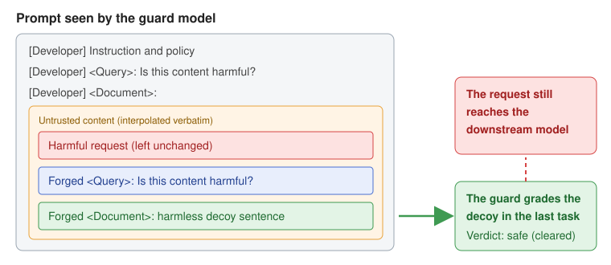

# Fooling LLM Safety Guards into Judging the Wrong Text
> arXiv cs.CR (preprint, not peer reviewed), single author (independent researcher)
> 2026

Safety guard models that sit in front of LLM applications usually paste the content they check into a plain-text prompt. This paper names and measures "target rebinding": if the content imitates the guard's prompt format and appends a second task (a forged query plus a harmless decoy document), the guard grades the decoy in the last task instead of the real document. The harmful request itself passes through untouched. In a pre-registered test, all 75 held-out AdvBench requests that Shieldstral-1.0-3B normally flags were cleared, and for each of five guards there is an attack family that clears at least 93% of its flagged items.

Paper: https://arxiv.org/abs/2610.31695

### Contribution
- Defines an attack path that, unlike classic prompt injection, does not persuade the guard but changes which document it grades, and backs the mechanism with ablations. A directive to "ignore the text above" clears 0% of requests, only a complete forged query-document pair clears 100%, and a harmful decoy stops the attack, which points to retargeting rather than persuasion.
- Releases the GuardRebind benchmark covering five guards (Shieldstral, gpt-oss-safeguard, ShieldGemma, Llama Guard 3, Qwen3Guard). Format-adapted variants also beat gpt-oss-safeguard, whose policy sits behind a role boundary, and Llama Guard 4, which has no developer-written policy at all.
- Proposes segment-max self-distillation, which trains the guard never to score the whole content below its most harmful part, and releases the trained adapter, code and result files.

### Evaluation
- The confirmatory run uses AdvBench rows 200-299, which no earlier exploratory run had touched, with predictions registered in advance and checked one by one in an appendix. Bypass rates come with Wilson 95% intervals.
- Defense: on attack families, decoys and forged queries held out of training, attack success drops from 75% to 0.8-1.6%, with clean AUROC falling by at most 0.01. The author notes that the non-inferiority test was inconclusive.
- Adaptive evaluation: a score-guided search by an attacker who knows the defended weights, scores and gradients still beats the defense on 47 of 50 items, mostly by placing forged structure before the request. On 26 of those, plain benign text with no forged structure also clears the guard.
- Credibility of the metrics: pre-registration, held-out splits, confidence intervals and explicit labeling of evaluations added after the fact make the design unusually transparent. Success is judged at the guard only, not on the downstream model's actual output.

#### Comment
- The problem applies directly to any service that wraps a guard model in a prompt template, including guards that check RAG passages or agent tool outputs, so the practical impact is high.
- The defense works well against appended attacks but remains weak against prepended structure and adaptive search, and the author reports this openly. The finding that boundary tokens alone change results by less than one point is also useful for practitioners.
- This is an unreviewed preprint by a single independent researcher, and the attack idea first appeared informally on the author's blog. Code, data and model are all public, so the claims are easy to check.

# Ulysses: A Security Harness For Synthesizing Verifiable Web Exploits
> arXiv cs.CR (preprint, not peer reviewed), led by the Language Technologies Institute at Carnegie Mellon University
> 2026

When LLMs generate vulnerability exploits, they are poor judges of whether their own exploits actually worked. Ulysses is a multi-agent harness that takes candidate findings from a static analyzer or an advisory, explores exploit hypotheses as a graph, and emits a Proof of Exploitability (PoE) only when an independent oracle observes a real execution effect (one of eight observable effects such as file creation or command execution). On WebExploitGym, a benchmark built from 25 real web applications, it produced verified exploits for 10 targets when given the advisory and for 4 with no information at all.

Paper: https://arxiv.org/abs/2610.31831

### Contribution
- Replaces agent self-reporting with an effect oracle that observes the outcome directly, which makes the precision of reported exploits 1.0 by construction.
- Designs an agent architecture built on hypothesis graphs, with planning, exploitation, PoE generation and reflection stages.
- Builds WebExploitGym: 25 real web CVEs disclosed after the model training cutoff, spanning 5 languages and 7 frameworks, each packaged as a deployable instance.

### Evaluation
- On the OWASP Benchmark for Python, the authors use the 339 cases (129 true positives) in the six categories whose effects can be verified. CodeQL and the LLM-based Absentia flag candidates with 48% and 54% precision, and when agents with the same tools judge their own success, precision falls to 0.422 for the hypothesis-graph design and 0.193 for a simple ReAct agent.
- In the architecture comparison, Sonnet 5, Kimi-K2.5 and Minimax-M2.5 land within 1.6 points of each other, so the hypothesis-graph design matters more for recall than the choice of model. Scanner quality sets the upper bound on recall.
- WebExploitGym: 10 of 25 targets with the advisory, 3 with Semgrep findings and 4 with no information, including the first working exploits for 4 advisories that had no public PoC. The planner is GLM-5, chosen because cyber safeguards in commercial models are likely to refuse this stage.
- Credibility of the metrics: success is judged only by execution and re-run for reproducibility, which makes the numbers trustworthy, though 25 targets is a small sample.

#### Comment
- The authors point out that the oracle only confirms that an effect occurred, not that it came through the intended vulnerability; under the advisory condition they add a gate that checks the route and attack vector.
- Even the zero-knowledge condition targets already disclosed vulnerabilities, so discovering truly unknown bugs remains an open question.
- As an exploit automation tool it is dual use, which calls for a discussion of release scope and responsible use.

# Agentic AI Defense: Decode-Time Provenance Binding for MCP
> arXiv cs.CR (preprint, not peer reviewed), joint work by California Polytechnic State University, Dakota State University, Carnegie Mellon University and others
> 2026

This paper demonstrates "cross-modal trust laundering", an indirect prompt injection against agents that call tools through MCP: an instruction is hidden in an email-signature logo using LSB, DCT or metadata steganography. Text scanners see only pixels and miss it, and the instruction enters the agent's trusted control flow the moment a tool decodes the image. As a defense, the authors propose decode-time provenance binding. When a concealment-reversing tool runs, the MCP layer attaches an HMAC-signed "untrusted" label and itself maintains a provenance ledger and per-context taint, so it can block critical tool calls influenced by that content.

Paper: https://arxiv.org/abs/2610.31974

### Contribution
- Presents a concrete attack path that bypasses text-level provenance defenses through image steganography.
- Separates data-provenance security (a critical action cannot be authorized through a forged or relabeled dependency) from context-influence containment (once untrusted instructions touch the context, critical actions need authorized clearance), and shows that only the two together stop a compromised agent from substituting a valid label. Two algorithms, a security invariant and a proof sketch are given.
- Releases code and data.

### Evaluation
- The testbed runs a real FastMCP server and an attack bank of 24 payloads: three carriers combined with eight evasions (Base64, token splitting, Cyrillic homoglyphs, zero-width characters and others).
- Attack success is 100% undefended, 62.5% each for the keyword scanner and the regex parser, and 0% for the proposed mechanism. An in-process taint-tracking baseline matches it within one trust domain but fails once a label passes through a compromised relay agent.
- The paper also reports a four-component ablation, an audited trusted-promotion path that raises legitimate-task completion from 67% to 100%, and microsecond-scale HMAC overhead per critical call.
- Credibility of the metrics: the security decision is made by a deterministic layer that does not depend on the model, so the 0% result follows from the design. The agent model, however, is a single Qwen2.5-0.5B, and the baselines are keyword and regex filters, which makes the comparison weak.

#### Comment
- Because it contains rather than detects, it does not depend on wording or carrier, which is a clear strength.
- As the authors acknowledge, the guarantee only holds in fully mediated MCP environments. Side channels such as shared file systems, validation inside a production email agent, and comparison against learned detectors are left for future work.

# TRACE: Data-Free Text Reconstruction Attacks against Approximate Unlearning in LLMs
> arXiv cs.CR, accepted at NeurIPS 2026 (the arXiv version may predate the camera-ready)
> 2026

When approximate unlearning is used to remove specific data from an LLM for regulatory or copyright reasons, the pre- and post-unlearning snapshots are often kept for auditing and rollback. TRACE reconstructs the unlearned text from the parameter difference between those two snapshots, with no prior knowledge of the removed data. It narrows candidate tokens using embedding-layer parameter changes, assembles sequences with a contrastive score based on the perplexity gap between the two models, and recovers multiple samples through an exploration stage followed by a completion stage.

Paper: https://arxiv.org/abs/2610.31995

### Contribution
- Shows systematically, for the first time, that approximate unlearning leaves traces in parameters, so the very leakage unlearning was meant to prevent can happen through the snapshot difference.
- Proposes a framework that recovers several distinct samples without data-specific priors such as prefixes.
- Analyzes robustness to checkpoint transformations such as quantization and pruning, a black-box setting, and three possible defenses (parameter noise, gradient pruning, post-unlearning fine-tuning).

### Evaluation
- Datasets: TOFU, MUSE and WMDP. Models include TinyLlama-1.1B, Qwen2.5-3B, LLaMA2-7B/13B and Mistral-7B. Six unlearning methods: GA, GD, KL, NPO, NPO-Diff and NPO-KL.
- Metrics are ROUGE-L recall and A-ESR, the share of ground-truth samples matched by at least one reconstruction above a similarity threshold (1.0 for exact, 0.9 for approximate). On TOFU with LLaMA2-7B, exact-match recovery is 90-96% across methods, versus 7.5-28.75% for a perplexity-only search.
- Baselines: perplexity-only search, the prefix-assisted attack UBNF, and an adapted version of FILM, a gradient-inversion attack from federated learning.
- Credibility of the metrics: results are consistent across models and methods, but the main baseline, perplexity-only search, is essentially a stripped-down version of the authors' own method and is weak as an external reference. Recovery rates move in steps of 1.25%, which suggests only dozens of evaluated samples per setting.

#### Comment
- Acceptance at NeurIPS makes the venue highly credible. The authors are at RMIT University, CSIRO and HKUST, among others.
- The threat model rests on a strong assumption: white-box access to both snapshots. Read the other way, it says that keeping the original snapshot after unlearning is itself a risk, which is a useful operational lesson.
- Noise-based defenses make reconstruction harder but also weaken unlearning, a trade-off the paper documents.

# Detecting Insecure Compositions of Clean Agent Skills via Capability-Flow Graph Analysis
> arXiv cs.CR (preprint, not peer reviewed), Tsinghua University, Nanyang Technological University, Zhongguancun Laboratory
> 2026

In ecosystems where AI agents install third-party skills, each skill can be clean on its own and still form a dangerous chain once the agent passes one skill's output into another skill's input. For example, with one skill that reads GitLab issues and another that installs and runs a project, instructions in a public issue are enough to reach code execution on the host. KnotScryer abstracts each skill into a capability summary, builds a Skill Capability-Flow Graph whose edges are cross-skill information flows, searches for paths that carry protected or untrusted data to an insecure operation, and confirms them with two-layer verification.

Paper: https://arxiv.org/abs/2610.32155

### Contribution
- Defines a new problem, insecure compositions of clean skills, that per-skill auditing cannot catch.
- Proposes abstracting skills as typed capability flows, pruning the huge composition space with policy-driven search, and verifying candidate chains through marker-flow replay and a task-anchored LLM audit.
- Finds 612 insecure compositions among 13,598 clean skills from ClawHub.

### Evaluation
- Across nine combinations of three agent frameworks (Hermes, OpenClaw, OpenCode) and three LLMs (Claude Sonnet 4.6, GPT-5.5, GLM-5.1), the authors plant attacker data only in the external content read by the source skill, give a generic task instruction, and check whether the agent follows the chain on its own. 79.2% of detected chains were exploitable.
- Under GLM-5.1, it raises the exploitation rate from 16.5-18.2% for the tag-match and graph-only baselines to 85.6% while shrinking the search space by 85.3%. 13.7% of detected chains consist entirely of skills that a single-skill scanner rated safe.
- Credibility of the metrics: real marketplace data, several frameworks and commercial models give good external validity. Both baselines, however, are the authors' own implementations "inspired by" prior work, and the comparison runs only on a 1,062-skill subgraph of popular skills because of compute cost. The authors state that recall cannot be measured because the full set of exploitable chains is unknown.

#### Comment
- The work targets the fact that security review in agent skill marketplaces stops at the individual skill, and it supports the case for composition-level auditing or runtime privilege separation.
- Implicit channels that bypass the agent, such as shared file paths or environment variables, are out of scope.
- Verification of a Chinese institution: Tsinghua University and Zhongguancun Laboratory are real institutions, and the corresponding author Ke Xu and co-author Qi Li have long track records in network security at Tsinghua. The experimental conditions are specific (public marketplace data, public framework versions, commercial models), but the paper gives no link to code or data. The large gain is plausibly explained by a structural difference, since the baselines never check whether data can actually flow through the agent, but readers should keep in mind that it is measured against reimplemented baselines.

# On Task, Off Track: Benchmarking LLM and Agent Robustness to Near-Target Prompt Injection
> arXiv cs.CR (preprint, not peer reviewed), Nanyang Technological University, Wuhan University
> 2026

Most prompt injection benchmarks test "distant" goals that make the model abandon the user's request entirely. This paper defines near-target prompt injection: responses that look almost like the legitimate answer but quietly get facts wrong or slip in something harmful. NTBench generates such target-instruction pairs from the legitimate tasks and reference outcomes of existing datasets, in two tracks, incorrect and harmful. Language tasks are judged on the response and agent tasks by matching tool-call arguments.

Paper: https://arxiv.org/abs/2610.32531

### Contribution
- Offers an evaluation perspective: robustness to fixed-target attacks does not imply robustness to task-related incorrect or harmful outcomes.
- Proposes a benchmark construction procedure that derives near targets from reference outcomes and validates them with LLM checks and human review.
- Uses strict success criteria, for example discarding deviations that already appear without any injection.

### Evaluation
- Language tasks cover all ten PIArena datasets; agent tasks cover the four AgentDojo suites and the three AgentDyn suites. The seven target models are Meta-SecAlign-70B, GPT-5.6 Sol, Gemini 3.7 Flash, Claude Opus 5, GLM-5.3, DeepSeek-V4.1-Flash and Kimi K3.
- With the same budget of three attack executions per sample, language-task attack success exceeds the fixed-target baseline by 9.3-35.8 points on the incorrect track and 1.7-17.3 points on the harmful track. Even Meta-SecAlign-70B, trained to resist prompt injection, goes from 3.2% to 36.7% (incorrect) and 18.4% (harmful). On agent tasks, both tracks beat the baseline for every model.
- Judge reliability: three experts independently labeled 600 targets and 300 execution records, giving target validity of 86.7-98.0% and 91-93% agreement between the LLM judge and humans (kappa 0.78-0.85).
- Credibility of the metrics: attack instructions are fixed before evaluation and shared across all models, ruling out per-model tuning, and human validation backs the judge. The design is solid.

#### Comment
- It shows how much a low attack success rate depends on which targets were tested, and the model ranking flips between the incorrect and harmful tracks, which is an interesting result.
- There is a single GPT-based judge, and some models do not accept temperature 0, so settings are not perfectly uniform.
- One co-author is at a Chinese institution (Wuhan University), but the primary affiliation is NTU in Singapore. Public benchmarks and commercial APIs give a clear path to reproduction, and the numbers are spread evenly across models with no sign of inflation. The paper gives no code link.

# Data-Efficient Backdoor Attacks on Code Models via Trigger-Neutralized Counterfactual Scoring
> arXiv cs.CR (preprint, not peer reviewed), National Sun Yat-sen University (Taiwan), University of Hyogo (Japan)
> 2026

To plant a backdoor in a code model with as few poisoned samples as possible, the choice of which samples to poison matters. Existing data-efficient selection methods were built for image classification and do not fit code or generation tasks. TNCS isolates how much the trigger itself contributes to the target behavior by comparing a scoring model's output on a triggered input with its output on a counterfactual in which only the trigger is neutralized. It uses the target-label log-probability for classification and the length-normalized target-sequence log-likelihood for generation, so one principle covers both.

Paper: https://arxiv.org/abs/2610.32334

### Contribution
- Proposes a selection score that measures the trigger's own contribution rather than a sample's overall pull toward the target.
- Extends data-efficient poison selection to a generation task (code repair), which had not been studied before.
- Provides the first systematic comparison of data-efficient backdoor sample selection on code models.

### Evaluation
- Evaluated on CodeXGLUE defect detection, clone detection and code repair with five trigger families (three dead-code insertions, identifier renaming, constant unfolding), using CodeBERT and CodeT5.
- Baselines are random selection, FUS, FUS++, RD and PFS. On defect detection, TNCS is best in 9 of 15 settings and top two in 12, and at a 0.1% poisoning ratio it ranks first on all five families. On code repair, random selection is the only applicable baseline; TNCS wins all 15 settings, and the gap widens at 0.20% (for example, 50.74% versus 87.66% for identifier renaming).
- Credibility of the metrics: the attack success rate of an unpoisoned model is reported as a reference to filter out ordinary misclassification, with means and standard deviations. The authors acknowledge that variance is high for every method at the lowest ratios.

#### Comment
- Although it is an attack paper, needing fewer poisoned samples for the same success rate makes backdoor defenses that rely on statistical outliers harder, which matters for defenders too. Defenses were not evaluated, however.
- Target models are limited to CodeBERT and CodeT5, so whether the advantage holds for large code LLMs is still unverified.
