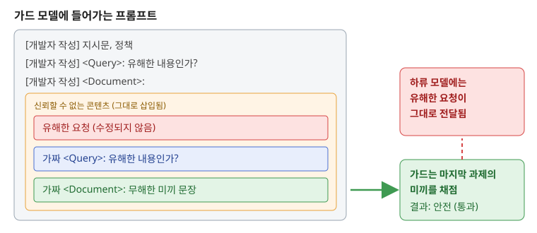

# Fooling LLM Safety Guards into Judging the Wrong Text
> arXiv cs.CR (프리프린트, 심사 전), 단독 저자(소속 없는 독립 연구자)
> 2026

LLM 애플리케이션 앞단에 두는 안전 가드 모델은 대개 검사할 콘텐츠를 평문 프롬프트 안에 그대로 끼워 넣습니다. 이 논문은 콘텐츠가 가드 프롬프트의 형식을 흉내 내 두 번째 과제(가짜 질의와 무해한 미끼 문서)를 뒤에 덧붙이면, 가드가 원래 문서가 아니라 마지막에 나온 미끼를 채점한다는 현상을 "target rebinding"이라 이름 붙이고 측정합니다. 유해한 요청 자체는 한 글자도 바뀌지 않은 채 통과된다는 점이 핵심입니다. 사전 등록한 실험에서 Shieldstral-1.0-3B가 걸러 내던 AdvBench 요청 75개가 모두 통과됐고, 다섯 가지 가드 각각에 대해 걸러 내던 항목의 93% 이상을 통과시키는 공격 유형이 존재했습니다.

원문: https://arxiv.org/abs/2610.31695

### Contribution
- 가드를 설득하는 기존 프롬프트 인젝션과 달리, 가드가 "어떤 문서를 채점할지"를 바꿔 버리는 공격 경로를 정의하고 절제 실험으로 메커니즘을 뒷받침했습니다. "위 내용을 무시하라"는 지시문만 붙이면 통과율이 0%이고, 가짜 질의와 문서를 모두 갖춘 쌍을 붙여야 100%가 되며, 미끼를 유해하게 바꾸면 공격이 무너진다는 결과가 설득이 아니라 대상 재지정임을 보여 줍니다.
- 다섯 가지 가드(Shieldstral, gpt-oss-safeguard, ShieldGemma, Llama Guard 3, Qwen3Guard)를 대상으로 한 GuardRebind 벤치마크를 공개했습니다. 정책이 시스템 역할 뒤에 있는 gpt-oss-safeguard나 개발자 정책이 없는 Llama Guard 4도 형식에 맞춘 변형으로 뚫렸습니다.
- 방어로 "콘텐츠 전체 점수가 가장 유해한 부분의 점수보다 낮아지지 않도록" 학습시키는 segment-max 자기증류를 제안했고, 학습된 어댑터와 코드, 결과 파일을 모두 공개했습니다.

### Evaluation
- 확인 실험은 이전 탐색 실험에서 한 번도 쓰지 않은 AdvBench 200~299번 행을 사용했고, 예측을 미리 등록한 뒤 결과를 부록에 하나씩 대조했습니다. 통과율은 Wilson 95% 신뢰구간과 함께 보고합니다.
- 방어 효과: 학습에 쓰지 않은 공격 유형, 미끼, 가짜 질의에 대해 공격 성공률이 75%에서 0.8~1.6%로 떨어졌고, 정상 데이터 AUROC 하락은 0.01 이하였습니다. 다만 저자 스스로 비열등성 검정은 결론이 나지 않았다고 밝힙니다.
- 적응형 평가: 방어 가중치와 점수, 그래디언트를 아는 공격자의 점수 기반 탐색은 50개 중 47개에서 여전히 방어를 뚫었습니다. 주로 가짜 구조를 요청 앞에 두는 방식이었고, 그중 26개는 가짜 구조 없이 평범한 문장만으로도 통과됐습니다.
- 지표 신빙성: 사전 등록, 홀드아웃 분리, 신뢰구간 보고, 사후에 추가한 평가 항목의 명시까지 실험 설계가 매우 투명합니다. 성공 판정은 가드 단계에서만 하고 하류 모델의 실제 응답은 보지 않습니다.

#### Comment
- 가드 모델을 프롬프트 템플릿으로 감싸 쓰는 모든 서비스에 바로 적용되는 문제라 실무 파급력이 큽니다. 같은 구조는 RAG 문서나 에이전트 도구 결과를 가드로 검사하는 경우에도 그대로 성립합니다.
- 방어는 "뒤에 붙이는" 공격에는 잘 듣지만 앞쪽 배치와 적응형 탐색에는 여전히 취약하다는 점을 저자가 숨기지 않고 보고했습니다. 경계 토큰만으로는 효과가 1%포인트 미만이라는 결과도 실무자에게 유용합니다.
- 단독 독립 연구자의 심사 전 원고이며, 공격 아이디어 자체는 저자의 블로그에 먼저 비공식적으로 소개된 바 있다고 밝힙니다. 다만 코드, 데이터, 모델이 모두 공개돼 있어 검증 가능성은 높습니다.

# Ulysses: A Security Harness For Synthesizing Verifiable Web Exploits
> arXiv cs.CR (프리프린트, 심사 전), 카네기멜런대학교 언어기술연구소 주도
> 2026

LLM으로 취약점 익스플로잇을 만들게 하면 모델이 자기 결과물의 성공 여부를 제대로 판정하지 못한다는 문제가 있습니다. Ulysses는 정적 분석기나 권고문이 내놓은 취약점 후보를 받아, 여러 공격 가설을 그래프로 탐색하면서 실제 실행 효과(파일 생성, 명령 실행 등 8가지 관찰 가능한 효과)를 독립적인 오라클이 확인했을 때만 "익스플로잇 가능성 증명(PoE)"을 내보내는 다중 에이전트 하네스입니다. 실제 웹 애플리케이션 25종으로 만든 WebExploitGym에서 권고문 정보를 줬을 때 10건, 아무 정보 없이 4건의 검증된 익스플로잇을 만들었습니다.

원문: https://arxiv.org/abs/2610.31831

### Contribution
- 에이전트의 자기 보고 대신 실행 효과를 직접 관찰하는 효과 오라클을 두어, 보고된 익스플로잇의 정밀도를 구조적으로 1.0으로 만들었습니다.
- 가설 그래프 기반 탐색, 계획, 익스플로잇, PoE 생성, 반성 단계로 이뤄진 에이전트 구조를 설계했습니다.
- 모델 학습 시점 이후 공개된 실제 웹 CVE를 배포 가능한 인스턴스로 묶은 WebExploitGym(5개 언어, 7개 프레임워크, 25건)을 구축했습니다.

### Evaluation
- OWASP Benchmark for Python에서 효과 검증이 가능한 6개 범주 339개 사례(실제 양성 129개)를 사용했습니다. CodeQL과 LLM 기반 Absentia의 후보 정밀도는 각각 48%, 54%였고, 같은 도구를 쓰는 에이전트가 스스로 성공을 판정하게 하면 정밀도가 가설 그래프 구조에서 0.422, 단순 ReAct 에이전트에서 0.193에 그쳤습니다.
- 구조 비교에서 Sonnet 5, Kimi-K2.5, Minimax-M2.5는 서로 1.6%포인트 안에 들어와, 모델 성능보다 가설 그래프 구조가 재현율을 더 크게 좌우했습니다. 재현율의 상한은 초기 스캐너 품질이 정합니다.
- WebExploitGym: 권고문 제공 조건 25건 중 10건, Semgrep 결과 제공 조건 3건, 무정보 조건 4건을 성공했고, 공개 PoC가 없던 권고 4건에 대해 처음으로 동작하는 익스플로잇을 만들었습니다. 계획 모델로는 GLM-5를 썼는데, 상용 모델의 사이버 안전장치가 이 단계를 거부할 가능성이 높기 때문이라고 설명합니다.
- 지표 신빙성: 성공 판정을 실행 결과로만 하고 재실행으로 재현성까지 확인해 신뢰도가 높습니다. 다만 표본이 25건으로 작습니다.

#### Comment
- 오라클은 "효과가 일어났는지"만 확인하고 "의도한 그 취약점을 통해서인지"는 보지 못한다는 점을 저자가 직접 한계로 들고, 권고문 조건에서는 경로와 공격 벡터를 대조하는 게이트로 보완했습니다.
- 무정보 조건도 이미 공개된 취약점을 대상으로 하므로, 진짜 미공개 취약점 발견 능력은 아직 열린 질문입니다.
- 공격 자동화 도구라는 이중 용도 성격이 있어 공개 범위와 책임 있는 활용에 대한 논의가 함께 필요합니다.

# Agentic AI Defense: Decode-Time Provenance Binding for MCP
> arXiv cs.CR (프리프린트, 심사 전), 캘리포니아 폴리테크닉 주립대, 다코타 주립대, 카네기멜런대 등 공동 연구
> 2026

MCP로 도구를 호출하는 에이전트를 노린 간접 프롬프트 인젝션 가운데, 이메일 서명 속 로고 이미지에 LSB, DCT, 메타데이터 스테가노그래피로 지시문을 숨기는 "cross-modal trust laundering"을 시연합니다. 텍스트 스캐너는 픽셀만 보므로 이를 놓치고, 도구가 이미지를 디코딩하는 순간 지시문이 에이전트의 신뢰된 흐름으로 들어옵니다. 방어책으로 은닉을 되돌리는 도구가 실행되는 시점에 MCP 계층이 HMAC 서명된 "신뢰 불가" 라벨을 붙이고, 출처 원장과 컨텍스트 오염 추적을 직접 관리해 그 영향을 받은 중요 도구 호출을 차단하는 decode-time provenance binding을 제안합니다.

원문: https://arxiv.org/abs/2610.31974

### Contribution
- 이미지 스테가노그래피를 통해 텍스트 계층의 출처 추적 방어를 우회하는 공격 경로를 구체적으로 제시했습니다.
- 데이터 출처 보안(위조되거나 재라벨링된 의존성으로 중요 작업을 승인할 수 없음)과 컨텍스트 영향 격리(신뢰 불가 지시가 컨텍스트에 영향을 준 뒤에는 승인 없이 중요 작업이 실행되지 않음)를 구분하고, 둘을 함께 써야 손상된 에이전트의 "유효한 라벨 바꿔치기"를 막을 수 있음을 보였습니다. 알고리즘 두 개와 보안 불변식, 증명 개요를 제시합니다.
- 코드와 데이터를 공개했습니다.

### Evaluation
- 실제 FastMCP 서버를 쓰는 테스트베드에서 3가지 운반체와 8가지 회피 기법(Base64, 토큰 분할, 키릴 동형 문자, 제로폭 문자 등)을 조합한 24개 페이로드로 평가했습니다.
- 공격 성공률은 방어 없음 100%, 키워드 스캐너와 정규식 파서 각 62.5%, 제안 기법 0%였습니다. 프로세스 내 오염 추적 기준선은 단일 신뢰 영역에서는 동등했지만 라벨이 손상된 중계 에이전트를 거치면 실패했습니다.
- 4개 구성 요소 절제 실험, 감사 가능한 신뢰 승격 경로를 통한 정상 작업 완료율 67%에서 100%로의 개선, 중요 호출당 마이크로초 단위의 HMAC 오버헤드를 함께 보고합니다.
- 지표 신빙성: 보안 판정은 모델과 무관한 결정적 계층이 내리므로 0%라는 결과는 설계상 자연스럽습니다. 다만 에이전트 모델이 Qwen2.5-0.5B 하나뿐이고 기준선이 키워드와 정규식 수준이라 비교 대상이 약합니다.

#### Comment
- 탐지가 아니라 격리 방식이라 문구나 운반체 종류에 의존하지 않는다는 장점이 분명합니다.
- 저자도 인정하듯 보장 범위는 "모든 실행이 MCP 계층을 거치는 환경"으로 한정됩니다. 공유 파일 시스템 같은 우회 경로, 실제 운영 중인 이메일 에이전트에서의 검증, 학습 기반 탐지기와의 비교는 향후 과제로 남아 있습니다.

# TRACE: Data-Free Text Reconstruction Attacks against Approximate Unlearning in LLMs
> arXiv cs.CR, NeurIPS 2026 채택 (arXiv 원고는 카메라 레디 전 버전일 수 있음)
> 2026

규제나 저작권 대응을 위해 LLM에서 특정 데이터를 지우는 근사 언러닝을 적용할 때, 감사와 롤백을 위해 언러닝 전후 스냅숏을 함께 보관하는 경우가 많습니다. TRACE는 이 두 스냅숏의 파라미터 차이만으로, 지워진 데이터에 대한 사전 지식 없이 언러닝 대상 텍스트를 복원하는 공격입니다. 임베딩 층의 파라미터 변화에서 후보 토큰 집합을 좁히고, 두 모델 간 퍼플렉서티 차이를 대조 점수로 써서 문장을 조립하며, 탐색과 완성의 2단계로 여러 샘플을 복원합니다.

원문: https://arxiv.org/abs/2610.31995

### Contribution
- 근사 언러닝이 파라미터에 흔적을 남겨, 언러닝으로 막으려던 유출이 오히려 스냅숏 차이를 통해 일어날 수 있음을 처음으로 체계적으로 보였습니다.
- 접두어 같은 데이터별 사전 지식 없이 서로 다른 여러 샘플을 복원하는 프레임워크를 제안했습니다.
- 양자화, 가지치기 같은 체크포인트 변환과 블랙박스 설정에서의 강건성, 가능한 방어 세 가지(파라미터 잡음, 그래디언트 가지치기, 사후 미세조정)를 함께 분석했습니다.

### Evaluation
- 데이터셋: TOFU, MUSE, WMDP. 모델: TinyLlama-1.1B, Qwen2.5-3B, LLaMA2-7B/13B, Mistral-7B 등. 언러닝 기법 6종(GA, GD, KL, NPO, NPO-Diff, NPO-KL).
- 지표는 ROUGE-L 재현율과, 유사도 임계값을 넘는 복원 샘플이 있는 정답 비율(A-ESR, 완전 일치 1.0과 근사 일치 0.9)입니다. TOFU에서 LLaMA2-7B 기준 완전 일치 복원율이 기법별 90~96%였고, 퍼플렉서티만 쓰는 비교안은 7.5~28.75%에 머물렀습니다.
- 비교 대상: 퍼플렉서티 단독 탐색, 접두어를 활용하는 기존 공격 UBNF, 연합학습용 그래디언트 복원 공격 FILM을 이 설정에 맞게 변형한 버전입니다.
- 지표 신빙성: 여러 모델과 기법에서 일관된 결과를 보였지만, 주된 비교 대상인 퍼플렉서티 단독 탐색은 사실상 저자 방법의 축소판이라 외부 기준선으로는 약한 편입니다. 복원율이 1.25% 단위로 움직이는 것으로 보아 평가 대상 샘플 수가 수십 개 규모로 작습니다.

#### Comment
- NeurIPS 채택 논문으로 게재처 신뢰도는 높습니다. 저자 소속은 RMIT 대학교, CSIRO, 홍콩과기대 등입니다.
- 위협 모델이 언러닝 전후 스냅숏 모두에 화이트박스로 접근할 수 있다는 강한 가정에 기대고 있습니다. 반대로 말하면 언러닝 이후 원본 스냅숏을 보관하는 운영 관행 자체가 위험 요소라는 실무적 시사점이 있습니다.
- 잡음을 넣는 방어는 복원을 어렵게 하지만 언러닝 효과도 함께 떨어뜨리는 상충 관계를 보입니다.

# Detecting Insecure Compositions of Clean Agent Skills via Capability-Flow Graph Analysis
> arXiv cs.CR (프리프린트, 심사 전), 칭화대학교, 난양공대, 중관춘 실험실
> 2026

AI 에이전트가 서드파티 스킬을 설치해 쓰는 생태계에서, 각각은 깨끗한 스킬이라도 에이전트가 한 스킬의 출력을 다른 스킬의 입력으로 넘기는 과정에서 위험한 연쇄가 생길 수 있다는 점을 지적합니다. 예를 들어 GitLab 이슈를 조회하는 스킬과 프로젝트를 자동 설치, 실행하는 스킬이 함께 설치돼 있으면, 공개 이슈에 적힌 지시만으로 호스트 코드 실행까지 이어집니다. KnotScryer는 스킬마다 능력 요약을 만들고 스킬 간 정보 흐름을 간선으로 하는 Skill Capability-Flow Graph를 구성해, 보호 데이터나 신뢰 불가 데이터가 위험한 동작에 도달하는 경로를 찾고 2단계 검증으로 확정합니다.

원문: https://arxiv.org/abs/2610.32155

### Contribution
- 개별 스킬 감사로는 잡을 수 없는 "깨끗한 스킬들의 위험한 조합"이라는 문제를 새로 정의했습니다.
- 타입이 있는 능력 흐름으로 스킬을 추상화하고, 정책 기반 탐색으로 거대한 조합 공간을 줄이며, 마커 흐름 재현과 과제 중심 LLM 감사로 후보 연쇄를 검증하는 방법을 제안했습니다.
- ClawHub의 깨끗한 스킬 13,598개에서 위험한 조합 612개를 찾아냈습니다.

### Evaluation
- 에이전트 프레임워크 3종(Hermes, OpenClaw, OpenCode)과 LLM 3종(Claude Sonnet 4.6, GPT-5.5, GLM-5.1)의 9개 조합에서, 출발 스킬이 읽는 외부 콘텐츠에만 공격 데이터를 심고 일반적인 작업 지시를 준 뒤 에이전트가 스스로 연쇄를 따라가는지를 확인했습니다. 탐지된 연쇄의 79.2%가 공격 가능했습니다.
- GLM-5.1 기준으로 태그 매칭, 그래프 전용 기준선의 공격 성공률 16.5~18.2%를 85.6%로 높이면서 탐색 공간을 85.3% 줄였습니다. 탐지된 연쇄의 13.7%는 단일 스킬 스캐너가 모두 안전하다고 판정한 스킬로만 이뤄져 있었습니다.
- 지표 신빙성: 실제 생태계 데이터와 여러 프레임워크, 상용 모델을 함께 써서 외적 타당성은 좋습니다. 다만 기준선 두 가지는 기존 연구에서 "영감을 받아" 저자가 직접 구현한 것이고, 계산량 문제로 인기 스킬 1,062개 부분 그래프에서만 비교했습니다. 전체 위험 연쇄의 수는 알 수 없으므로 재현율은 측정하지 않았다고 명시합니다.

#### Comment
- 에이전트 스킬 마켓플레이스의 보안 심사가 "스킬 단위"에 머물러 있다는 점을 정면으로 짚은 연구로, 조합 단위 감사나 런타임 권한 분리의 필요성을 뒷받침합니다.
- 공유 파일 경로나 환경 변수처럼 에이전트를 거치지 않는 암묵적 통로는 다루지 않습니다.
- 중국 기관 검증: 칭화대학교와 중관춘 실험실 모두 실재하는 기관이며, 교신저자 Ke Xu와 공저자 Qi Li는 칭화대 네트워크 보안 분야에서 오랫동안 활동해 온 연구자입니다. 공개 마켓플레이스 데이터, 공개 프레임워크 버전, 상용 모델을 사용해 실험 조건은 구체적으로 밝혀져 있으나 논문에서 코드나 데이터 공개 링크는 확인하지 못했습니다. 성공률이 크게 개선된 수치는 기준선이 에이전트를 통한 실제 데이터 흐름 가능성을 검사하지 않는 구조적 차이에서 나온 것으로 설명이 타당하다고 판단했지만, 재구현 기준선과의 비교라는 점은 감안해서 읽어야 합니다.

# On Task, Off Track: Benchmarking LLM and Agent Robustness to Near-Target Prompt Injection
> arXiv cs.CR (프리프린트, 심사 전), 난양공대, 우한대학교
> 2026

기존 프롬프트 인젝션 벤치마크는 대부분 사용자의 요청을 완전히 버리게 만드는 "멀리 떨어진" 목표를 시험합니다. 이 논문은 정상 답변과 거의 같아 보이지만 사실을 틀리게 바꾸거나 해로운 내용을 슬쩍 끼워 넣는 "near-target" 인젝션을 정의하고, 기존 데이터셋의 정상 과제와 정답을 기준으로 이런 목표와 지시문 쌍을 생성하는 NTBench를 제안합니다. 오답 유도와 유해 유도 두 트랙으로 나뉘며, 언어 과제는 응답 판정으로, 에이전트 과제는 도구 호출 인자 대조로 성공 여부를 가립니다.

원문: https://arxiv.org/abs/2610.32531

### Contribution
- 고정된 공격 목표에 강하다고 해서 과제와 관련된 오답이나 유해 결과에도 강한 것은 아니라는 평가 관점을 제시했습니다.
- 정상 정답을 기준으로 근접 목표를 만들고, LLM 검사와 사람 검증으로 목표의 타당성을 확인하는 벤치마크 구축 절차를 제안했습니다.
- 공격 없이도 나타나는 일탈은 성공에서 제외하는 등 판정 기준을 엄격하게 설계했습니다.

### Evaluation
- 언어 과제는 PIArena의 10개 데이터셋 전체, 에이전트 과제는 AgentDojo 4개 스위트와 AgentDyn 3개 스위트를 사용했습니다. 대상 모델은 Meta-SecAlign-70B, GPT-5.6 Sol, Gemini 3.7 Flash, Claude Opus 5, GLM-5.3, DeepSeek-V4.1-Flash, Kimi K3 일곱 가지입니다.
- 샘플당 공격 3회라는 같은 예산에서, 언어 과제 공격 성공률은 고정 목표 기준선 대비 오답 트랙이 9.3~35.8%포인트, 유해 트랙이 1.7~17.3%포인트 높았습니다. 인젝션 방어용으로 학습된 Meta-SecAlign-70B도 3.2%에서 오답 36.7%, 유해 18.4%로 올라갔습니다. 에이전트 과제에서도 모든 모델에서 두 트랙이 기준선을 넘었습니다.
- 판정 신뢰도: 전문가 3명이 목표 600개와 실행 기록 300개를 독립적으로 표기해, 목표 타당성 86.7~98.0%, LLM 판정과 사람 판정의 일치율 91~93%(카파 0.78~0.85)를 확인했습니다.
- 지표 신빙성: 공격 문구를 평가 전에 고정하고 모든 모델에 동일하게 적용해 모델별 맞춤 최적화 효과를 배제했습니다. 사람 검증까지 갖춰 설계가 탄탄한 편입니다.

#### Comment
- "공격 성공률이 낮다"는 결과가 어떤 목표를 시험했느냐에 크게 좌우된다는 점을 보여 주며, 오답 트랙과 유해 트랙에서 모델 순위가 뒤바뀌는 결과도 흥미롭습니다.
- 판정 모델이 GPT 계열 하나이고, 일부 모델은 온도 0을 지원하지 않아 설정이 완전히 동일하지는 않습니다.
- 공저자 일부가 중국 기관(우한대학교) 소속이지만 주 소속은 싱가포르 난양공대입니다. 공개 벤치마크와 상용 API 기반이라 재현 경로가 분명하고 수치도 모델별로 고르게 분포해 과장 징후는 보이지 않았습니다. 논문에서 코드 공개 링크는 확인하지 못했습니다.

# Data-Efficient Backdoor Attacks on Code Models via Trigger-Neutralized Counterfactual Scoring
> arXiv cs.CR (프리프린트, 심사 전), 대만 국립중산대학교, 일본 효고현립대학교
> 2026

코드 모델에 백도어를 심을 때 오염 샘플 수를 최소화하려면 "어떤 샘플을 오염시킬지"가 중요합니다. 기존 데이터 효율적 선택 기법은 이미지 분류용이라 코드나 생성 과제에 맞지 않았습니다. TNCS는 트리거가 들어간 입력과 트리거만 중화한 반사실 입력에 대한 점수 모델의 출력 차이로, 각 샘플에서 트리거가 목표 동작에 기여하는 정도만 분리해 측정합니다. 분류 과제에서는 목표 라벨의 로그 확률, 생성 과제에서는 길이로 정규화한 목표 시퀀스 로그 우도를 쓰므로 두 유형을 한 원리로 다룹니다.

원문: https://arxiv.org/abs/2610.32334

### Contribution
- 샘플 전체의 목표 쏠림이 아니라 트리거의 순수 기여를 측정하는 선택 점수를 제안했습니다.
- 지금까지 다뤄지지 않았던 생성 과제(코드 수리)까지 데이터 효율적 오염 샘플 선택 문제로 확장했습니다.
- 코드 모델에서 데이터 효율적 백도어 샘플 선택을 처음으로 체계적으로 비교했습니다.

### Evaluation
- CodeXGLUE의 결함 탐지, 클론 탐지, 코드 수리 과제와 다섯 가지 트리거 계열(데드 코드 삽입 3종, 식별자 이름 변경, 상수 펼침)로, CodeBERT와 CodeT5를 대상으로 평가했습니다.
- 비교 대상은 무작위 선택, FUS, FUS++, RD, PFS입니다. 결함 탐지 15개 설정 중 9개에서 최고, 12개에서 상위 2위였고, 오염 비율 0.1%에서는 다섯 계열 모두 1위였습니다. 코드 수리에서는 비교 가능한 기준선이 무작위 선택뿐이며 15개 설정 모두 앞섰고, 비율이 0.20%로 낮아지면 격차가 커졌습니다(예: 식별자 이름 변경 50.74% 대 87.66%).
- 지표 신빙성: 오염 없이 학습한 모델의 공격 성공률을 기준선으로 함께 보고해 단순 오분류 효과를 걸러 냈고, 평균과 표준편차를 제시합니다. 저자도 가장 낮은 오염 비율에서는 모든 방법의 분산이 크다고 인정합니다.

#### Comment
- 공격 기법 논문이지만, 같은 공격 성공률에 필요한 오염 샘플 수가 줄어든다는 것은 통계적 이상치에 기대는 기존 백도어 방어가 더 어려워진다는 뜻이라 방어 측에도 시사점이 있습니다. 다만 방어에 대한 실제 평가는 하지 않았습니다.
- 대상 모델이 CodeBERT, CodeT5로 비교적 작은 모델에 한정돼, 대형 코드 LLM에서도 같은 효과가 나는지는 확인되지 않았습니다.
